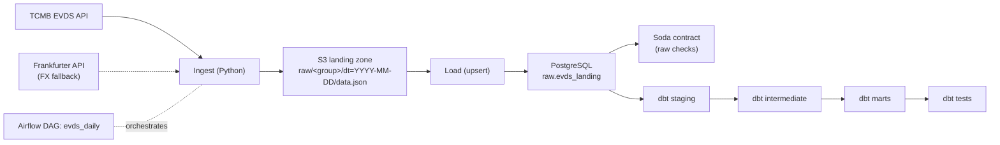
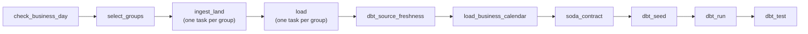

# TCMB EVDS Pipeline: Airflow, S3 and dbt

Turkish version: [tr/README.md](tr/README.md)

A daily batch data pipeline for Turkish central bank (TCMB EVDS) series: exchange rates, deposit and loan rates, loan and deposit volumes, policy rate and funding cost.
Airflow orchestrates the run. Python ingests the data into an S3 landing zone. A load step writes it to PostgreSQL. dbt models it. Soda and dbt tests check data quality.
Everything runs in Docker.

If the EVDS API fails, the pipeline falls back to Frankfurter (ECB rates) for FX series. Each row records its `source` and `fallback_reason`.

## Architecture



| Layer | What it does |
|---|---|
| Ingest | Calls EVDS (retry, timeout). Falls back to Frankfurter for FX. |
| Landing | Writes one JSON file per group and day to S3. Same `dt` overwrites (idempotent). |
| Load | Reads the JSON from S3 and upserts it into `raw.evds_landing`. |
| Staging | Long format, type casting, date parsing. |
| Intermediate | Dedup (latest `ingested_at`), fallback code mapping, source priority (EVDS first). |
| Marts | `dim_date`, `dim_series`, `fct_rates`, `fct_rates_daily`, `fct_volumes`. |

S3 runs on LocalStack in Docker. The endpoint is set with `AWS_ENDPOINT_URL_S3`.

## Data sources

21 series in 7 groups. Config: `config/series.yaml`.

| Group | Frequency | Series | Measure |
|---|---|---|---|
| `fx_rates` | business daily | 6 (USD, EUR, GBP buying and selling) | rate |
| `funding_cost` | business daily | 1 (CBRT weighted average funding cost) | rate |
| `deposit_rates` | weekly (Friday) | 3 (TRY, USD, EUR) | rate |
| `loan_rates` | weekly (Friday) | 5 (personal, vehicle, housing, commercial, consumer) | rate |
| `loan_volumes` | weekly (Friday) | 3 | volume |
| `deposit_volumes` | weekly (Friday) | 2 | volume |
| `policy_rate` | monthly | 1 (CBRT policy rate) | rate |

## Tech stack

| Area | Tool |
|---|---|
| Orchestration | Apache Airflow 3.1.8 (Python 3.12, LocalExecutor) |
| Ingestion | Python, `requests`, `PyYAML`, `holidays` |
| Landing zone | S3 via `boto3` (LocalStack 2026.08.0 in Docker) |
| Warehouse | PostgreSQL 16 (`psycopg2`) |
| Transformation | dbt Core 1.11 (`dbt-postgres`) |
| Data quality | dbt tests, Soda Core v4 (`soda-postgres`) |
| Tests | `pytest` (unit and integration) |
| Runtime | Docker Compose |

dbt and Soda run in separate virtual environments inside the Airflow image.

### Docker services

| Service | Role | Host port |
|---|---|---|
| `warehouse` | PostgreSQL warehouse | 5433 |
| `localstack` | S3 emulator | 4566 |
| `airflow-db` | Airflow metadata database | - |
| `airflow-init` | One-time Airflow setup | - |
| `airflow-apiserver` | Airflow UI and API | 8080 |
| `airflow-scheduler` | Scheduler | - |
| `airflow-dag-processor` | DAG parsing | - |
| `airflow-triggerer` | Triggerer | - |

## Repository structure

```
config/          series.yaml (series list), extra_closed_days.yaml
dags/            evds_daily.py (Airflow DAG)
src/
  ingestion/     EVDS and Frankfurter clients, fallback logic, business calendar
  landing/       S3 writer
  load/          PostgreSQL loader, business calendar loader
  simulation/    Slice EVDS data into parts, compare incremental and full-refresh results
  tools/         Seed generators (series metadata, TR holidays)
dbt/
  models/        staging, intermediate, marts
  seeds/         series_metadata, tr_holidays
  tests/         singular tests
  macros/        generate_schema_name
soda/            raw data contract, run_contract.sh wrapper
scripts/         check_idempotency.sh, s3_landing_hash.py
tests/           pytest suites
warehouse/init/  SQL for the raw schema
localstack/init/ S3 bucket creation hook
compose.yaml, Dockerfile, requirements*.txt
```

## Getting started

### Prerequisites

- Docker and Docker Compose
- An EVDS API key (free): register at the TCMB EVDS web site
- A LocalStack auth token

### Setup

1. Copy the example env file and fill in the values:

   ```bash
   cp .env.example .env
   ```

2. Set `EVDS_API_KEY` and `LOCALSTACK_AUTH_TOKEN`.
3. Set your own passwords and secrets for the warehouse, Airflow DB and Airflow admin user.
4. Generate your own values for `AIRFLOW_FERNET_KEY`, `AIRFLOW_JWT_SECRET` and `AIRFLOW_API_SECRET_KEY`.
5. Start all services:

   ```bash
   docker compose up -d --build
   ```

6. Open the Airflow UI at `http://localhost:8080` and sign in with `AIRFLOW_ADMIN_USER`.

`.env` is in `.gitignore`. API keys and passwords never go into the repository.

## Running the pipeline

### Daily DAG

DAG `evds_daily` runs on weekdays at 17:00 (Europe/Istanbul). Unpause it in the UI or with the CLI:

```bash
docker compose exec airflow-scheduler airflow dags unpause evds_daily
```



- `check_business_day` skips all downstream tasks on weekends and Turkish public holidays.
- `select_groups` picks only the groups that have data for the run date (`available_from` in `config/series.yaml`).
- Each ingest task re-reads a lookback window per group, so late EVDS revisions are picked up.
- A failed check stops the run. A warning continues but stays visible in the logs.

### Backfill

Example: the pilot range.

```bash
docker compose exec airflow-scheduler airflow backfill create \
  --dag-id evds_daily \
  --from-date 2024-06-28 --to-date 2024-07-15 \
  --max-active-runs 1
```

- `--max-active-runs 1` is required. A backfill does not follow the DAG `max_active_runs`.
- `--to-date` is not included.
- The DAG must be unpaused.

### Manual runs

On Git Bash for Windows, put `MSYS_NO_PATHCONV=1` in front of commands that use container paths.

```bash
# Unit and integration tests
MSYS_NO_PATHCONV=1 docker compose exec -w /opt/pipeline airflow-scheduler python -W ignore -m pytest tests -q

# Soda raw data contract for one date
MSYS_NO_PATHCONV=1 docker compose exec -w /opt/pipeline airflow-scheduler bash soda/run_contract.sh soda/contracts/raw/evds_landing.yml 2026-11-20

# Idempotency check: runs the DAG twice and compares warehouse, marts and S3
bash scripts/check_idempotency.sh 2026-11-20
```

## Data model

| Layer | Models | Notes |
|---|---|---|
| Staging | `stg_evds__observations`, `stg_frankfurter__fx_rates` | Long format, type casting, monthly date parsing. |
| Intermediate | `int_evds_observations_deduped`, `int_frankfurter_fx_rates_mapped`, `int_observations_unioned` | Latest `ingested_at` wins. Frankfurter pairs map to EVDS series codes. EVDS has priority over the fallback. Null values are filtered. |
| Marts | `dim_date`, `dim_series`, `fct_rates`, `fct_rates_daily`, `fct_volumes` | `fct_rates_daily` forward fills rates up to `max_fill_days` and flags filled rows with `is_filled`. Volumes are never filled. |
| Seeds | `series_metadata`, `tr_holidays` | `series_metadata` is generated from `config/series.yaml`. |

Fact models are incremental. An incremental simulation loads the data in parts and compares the result with a `--full-refresh` build (`src/simulation/`).

## Data quality

| Check | Where | Level |
|---|---|---|
| Source freshness on `ingested_at` | dbt | warn after 24 h, error after 48 h |
| Generic tests: `unique`, `not_null`, `relationships`, `accepted_values` | dbt (sources, staging, intermediate, seeds, marts) | error |
| 8 singular tests: series code exists in seed, `fct_rates_daily` consistency (fill days, no date gaps, no source on empty rows), FX rate positive, weekly observation on Friday | dbt (`dbt/tests/`) | error |
| Observation date lag (daily 7, weekly 14, monthly 75 days) | dbt singular test | warn |
| Raw data contract on `raw.evds_landing`: schema, empty `items`, `fallback_reason` consistency, `dt` not in the future, no `dt` gaps per group (business days only), `s3_key` consistency, valid `group_name` | Soda | error or warn per check |

Fail rule: an error stops the run. A warning continues but stays visible in the logs.
`soda/run_contract.sh` maps Soda exit codes to this rule. dbt returns exit code 1 on `error` and 0 on `warn`.

## Reliability

- **Idempotent landing.** One S3 object per group and `dt`. A re-run overwrites it.
- **Idempotent load.** Primary key plus upsert into `raw.evds_landing`.
- **Idempotent models.** dbt dedups by latest `ingested_at`.
- **Idempotency check.** `scripts/check_idempotency.sh <date>` runs the DAG twice. It compares the warehouse, the dbt marts and the S3 objects. Volatile columns (`ingested_at`, `dbt_updated_at`) are excluded. Result for `2026-11-20`: `PASS: idempotent`.
- **Retry and timeouts.** Default 2 retries, 2 minutes apart. `ingest_land` has 3 retries with exponential backoff. Quality tasks do not retry. `dagrun_timeout` is 2 hours.
- **Lookback window.** Each group re-reads recent days (daily 14, weekly rates 35, weekly volumes 56, monthly 90) to catch late revisions.
- **Business calendar.** Weekends and Turkish public holidays skip the run. Extra closed days go to `config/extra_closed_days.yaml`.
- **Backfill floor.** `available_from` per group in `config/series.yaml`.

## Testing

`pytest` covers the clients (mocked HTTP), the S3 writer, the loaders, the business calendar, the seed generators and the simulation tools. Integration tests run against LocalStack and the warehouse.

## Results

- Pilot backfill: 11 business-day runs from `2024-06-28` to `2024-07-12`. All runs succeeded (ingest, load, Soda and dbt).
- Idempotency check: `PASS` for `2026-11-20` (warehouse, marts and S3).

<!-- PLACEHOLDER (add after P4-A6-S7 is done): full backfill result, 2024-07 to today, run counts and date range. Write only what was done. -->

## dbt docs

<!-- PLACEHOLDER (add after P4-A7-S0 is done): dbt docs lineage graph screenshot in docs/, then link it here. -->

## Notes and limits

- S3 is emulated with LocalStack. No real AWS account is needed to run the project.
- The Frankfurter fallback covers FX series only.
- `loan_volumes` and `deposit_volumes` start at `2024-06-28`. Other groups start earlier (see `available_from`).
