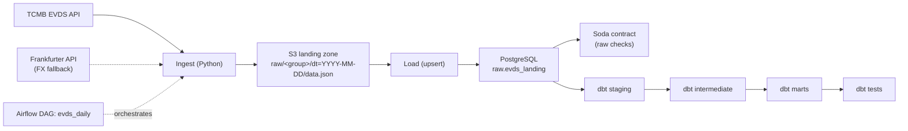
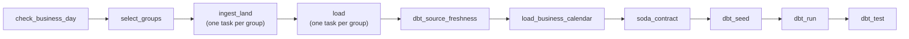

# TCMB EVDS Pipeline: Airflow, S3 and dbt

Türkiye Cumhuriyet Merkez Bankası (TCMB EVDS) serileri için günlük çalışan bir batch data pipeline: döviz kurları, mevduat ve kredi faizleri, kredi ve mevduat hacimleri, politika faizi ve fonlama maliyeti.
Airflow çalıştırmayı yönetir. Python veriyi S3 landing zone'a alır (ingest). Bir load adımı veriyi PostgreSQL'e yazar. dbt veriyi modeller. Soda ve dbt testleri veri kalitesini kontrol eder.
Her şey Docker içinde çalışır.

EVDS API hata verirse pipeline, FX serileri için Frankfurter'a (ECB kurları) geçer (fallback). Her satır `source` ve `fallback_reason` bilgisini taşır.

## Architecture



| Katman | Ne yapar |
|---|---|
| Ingest | EVDS'yi çağırır (retry, timeout). FX için Frankfurter'a fallback yapar. |
| Landing | Her grup ve gün için S3'e bir JSON dosyası yazar. Aynı `dt` üzerine yazar (idempotent). |
| Load | S3'teki JSON'u okur ve `raw.evds_landing` tablosuna upsert eder. |
| Staging | Long format, tip dönüşümü, tarih parse. |
| Intermediate | Dedup (en son `ingested_at`), fallback kod eşleme, kaynak önceliği (önce EVDS). |
| Marts | `dim_date`, `dim_series`, `fct_rates`, `fct_rates_daily`, `fct_volumes`. |

S3, Docker içinde LocalStack üzerinde çalışır. Endpoint `AWS_ENDPOINT_URL_S3` ile ayarlanır.

## Data sources

21 seri, 7 grup. Config: `config/series.yaml`.

| Grup | Frekans | Seri | Ölçü |
|---|---|---|---|
| `fx_rates` | business daily (iş günü) | 6 (USD, EUR, GBP alış ve satış) | rate |
| `funding_cost` | business daily (iş günü) | 1 (CBRT ağırlıklı ortalama fonlama maliyeti) | rate |
| `deposit_rates` | haftalık (Cuma) | 3 (TRY, USD, EUR) | rate |
| `loan_rates` | haftalık (Cuma) | 5 (kişisel, taşıt, konut, ticari, tüketici) | rate |
| `loan_volumes` | haftalık (Cuma) | 3 | volume |
| `deposit_volumes` | haftalık (Cuma) | 2 | volume |
| `policy_rate` | aylık | 1 (CBRT politika faizi) | rate |

## Tech stack

| Alan | Araç |
|---|---|
| Orchestration | Apache Airflow 3.1.8 (Python 3.12, LocalExecutor) |
| Ingestion | Python, `requests`, `PyYAML`, `holidays` |
| Landing zone | S3, `boto3` ile (Docker içinde LocalStack 2026.08.0) |
| Warehouse | PostgreSQL 16 (`psycopg2`) |
| Transformation | dbt Core 1.11 (`dbt-postgres`) |
| Data quality | dbt tests, Soda Core v4 (`soda-postgres`) |
| Tests | `pytest` (unit ve integration) |
| Runtime | Docker Compose |

dbt ve Soda, Airflow image'ı içinde ayrı virtual environment'larda çalışır.

### Docker services

| Servis | Rol | Host port |
|---|---|---|
| `warehouse` | PostgreSQL warehouse | 5433 |
| `localstack` | S3 emülatörü | 4566 |
| `airflow-db` | Airflow metadata veritabanı | - |
| `airflow-init` | Tek seferlik Airflow kurulumu | - |
| `airflow-apiserver` | Airflow UI ve API | 8080 |
| `airflow-scheduler` | Scheduler | - |
| `airflow-dag-processor` | DAG parse etme | - |
| `airflow-triggerer` | Triggerer | - |

## Repository structure

```
config/          series.yaml (seri listesi), extra_closed_days.yaml
dags/            evds_daily.py (Airflow DAG)
src/
  ingestion/     EVDS ve Frankfurter client'ları, fallback mantığı, business calendar
  landing/       S3 writer
  load/          PostgreSQL loader, business calendar loader
  simulation/    EVDS verisini parçalara böl, incremental ve full-refresh sonuçlarını karşılaştır
  tools/         Seed generator'lar (series metadata, TR holidays)
dbt/
  models/        staging, intermediate, marts
  seeds/         series_metadata, tr_holidays
  tests/         singular tests
  macros/        generate_schema_name
soda/            raw data contract, run_contract.sh wrapper
scripts/         check_idempotency.sh, s3_landing_hash.py
tests/           pytest suite'leri
warehouse/init/  raw şema için SQL
localstack/init/ S3 bucket oluşturma hook'u
compose.yaml, Dockerfile, requirements*.txt
```

## Getting started

### Prerequisites

- Docker ve Docker Compose
- Bir EVDS API key (ücretsiz): TCMB EVDS web sitesinden kayıt ol
- Bir LocalStack auth token

### Setup

1. Örnek env dosyasını kopyala ve değerleri doldur:

   ```bash
   cp .env.example .env
   ```

2. `EVDS_API_KEY` ve `LOCALSTACK_AUTH_TOKEN` değerlerini yaz.
3. Warehouse, Airflow DB ve Airflow admin user için kendi password ve secret'larını belirle.
4. `AIRFLOW_FERNET_KEY`, `AIRFLOW_JWT_SECRET` ve `AIRFLOW_API_SECRET_KEY` için kendi değerlerini üret.
5. Tüm servisleri başlat:

   ```bash
   docker compose up -d --build
   ```

6. Airflow UI'ı `http://localhost:8080` adresinde aç ve `AIRFLOW_ADMIN_USER` ile giriş yap.

`.env` dosyası `.gitignore` içindedir. API key'ler ve password'ler repository'ye asla girmez.

## Running the pipeline

### Daily DAG

`evds_daily` DAG'ı hafta içi her gün 17:00'de (Europe/Istanbul) çalışır. UI'dan veya CLI ile unpause et:

```bash
docker compose exec airflow-scheduler airflow dags unpause evds_daily
```



- `check_business_day`, hafta sonu ve Türkiye resmi tatillerinde tüm alt task'ları skip eder.
- `select_groups`, sadece çalışma tarihi için verisi olan grupları seçer (`config/series.yaml` içindeki `available_from`).
- Her ingest task, grup başına bir lookback penceresini yeniden okur. Böylece EVDS'nin geç revizyonları alınır.
- Başarısız bir check run'ı durdurur. Bir warning devam eder ama log'larda görünür kalır.

### Backfill

Örnek: pilot aralık.

```bash
docker compose exec airflow-scheduler airflow backfill create \
  --dag-id evds_daily \
  --from-date 2024-06-28 --to-date 2024-07-15 \
  --max-active-runs 1
```

- `--max-active-runs 1` zorunludur. Backfill, DAG'ın `max_active_runs` ayarını izlemez.
- `--to-date` dahil değildir.
- DAG unpaused olmalıdır.

### Manual runs

Windows'ta Git Bash kullanıyorsan, container path kullanan komutların başına `MSYS_NO_PATHCONV=1` koy.

```bash
# Unit ve integration testleri
MSYS_NO_PATHCONV=1 docker compose exec -w /opt/pipeline airflow-scheduler python -W ignore -m pytest tests -q

# Tek bir tarih için Soda raw data contract
MSYS_NO_PATHCONV=1 docker compose exec -w /opt/pipeline airflow-scheduler bash soda/run_contract.sh soda/contracts/raw/evds_landing.yml 2026-11-20

# Idempotency check: DAG'ı iki kez çalıştırır, warehouse, marts ve S3'ü karşılaştırır
bash scripts/check_idempotency.sh 2026-11-20
```

## Data model

| Katman | Model'ler | Notlar |
|---|---|---|
| Staging | `stg_evds__observations`, `stg_frankfurter__fx_rates` | Long format, tip dönüşümü, aylık tarih parse. |
| Intermediate | `int_evds_observations_deduped`, `int_frankfurter_fx_rates_mapped`, `int_observations_unioned` | En son `ingested_at` kazanır. Frankfurter pair'leri EVDS seri kodlarına eşlenir. EVDS, fallback'e göre önceliklidir. Null değerler filtrelenir. |
| Marts | `dim_date`, `dim_series`, `fct_rates`, `fct_rates_daily`, `fct_volumes` | `fct_rates_daily`, rate'leri `max_fill_days` sınırına kadar forward fill eder ve doldurulan satırları `is_filled` ile işaretler. Volume'lar asla doldurulmaz. |
| Seeds | `series_metadata`, `tr_holidays` | `series_metadata`, `config/series.yaml` dosyasından üretilir. |

Fact model'ler incremental'dır. Incremental simulation, veriyi parçalar halinde yükler ve sonucu `--full-refresh` build ile karşılaştırır (`src/simulation/`).

## Data quality

| Kontrol | Nerede | Seviye |
|---|---|---|
| `ingested_at` üzerinde source freshness | dbt | 24 saat sonra warn, 48 saat sonra error |
| Generic tests: `unique`, `not_null`, `relationships`, `accepted_values` | dbt (sources, staging, intermediate, seeds, marts) | error |
| 8 singular test: series code seed'de var, `fct_rates_daily` tutarlılığı (fill günleri, tarih boşluğu yok, boş satırda source yok), FX rate pozitif, haftalık gözlem Cuma günü | dbt (`dbt/tests/`) | error |
| Gözlem tarihi gecikmesi (günlük 7, haftalık 14, aylık 75 gün) | dbt singular test | warn |
| `raw.evds_landing` üzerinde raw data contract: schema, boş `items`, `fallback_reason` tutarlılığı, `dt` gelecekte değil, grup başına `dt` boşluğu yok (sadece iş günleri), `s3_key` tutarlılığı, geçerli `group_name` | Soda | check başına error veya warn |

Fail kuralı: bir error run'ı durdurur. Bir warning devam eder ama log'larda görünür kalır.
`soda/run_contract.sh`, Soda exit code'larını bu kurala eşler. dbt, `error` durumunda exit code 1, `warn` durumunda 0 döner.

## Reliability

- **Idempotent landing.** Grup ve `dt` başına bir S3 object. Yeniden çalıştırma üzerine yazar.
- **Idempotent load.** `raw.evds_landing` içine primary key ve upsert.
- **Idempotent models.** dbt, en son `ingested_at` ile dedup yapar.
- **Idempotency check.** `scripts/check_idempotency.sh <date>` DAG'ı iki kez çalıştırır. Warehouse'u, dbt marts'ı ve S3 object'lerini karşılaştırır. Değişken kolonlar (`ingested_at`, `dbt_updated_at`) hariç tutulur. `2026-11-20` sonucu: `PASS: idempotent`.
- **Retry ve timeout.** Varsayılan 2 retry, 2 dakika arayla. `ingest_land` exponential backoff ile 3 retry yapar. Kalite task'ları retry yapmaz. `dagrun_timeout` 2 saattir.
- **Lookback window.** Her grup son günleri yeniden okur (günlük 14, haftalık rate 35, haftalık volume 56, aylık 90). Böylece geç revizyonlar yakalanır.
- **Business calendar.** Hafta sonu ve Türkiye resmi tatilleri run'ı skip eder. Ek kapalı günler `config/extra_closed_days.yaml` dosyasına yazılır.
- **Backfill floor.** `config/series.yaml` içinde grup başına `available_from`.

## Testing

`pytest`; client'ları (mock HTTP), S3 writer'ı, loader'ları, business calendar'ı, seed generator'ları ve simulation tool'larını kapsar. Integration test'ler LocalStack ve warehouse'a karşı çalışır.

## Results

- Pilot backfill: `2024-06-28` ile `2024-07-12` arası 11 iş günü run'ı. Tüm run'lar başarılı (ingest, load, Soda ve dbt).
- Idempotency check: `2026-11-20` için `PASS` (warehouse, marts ve S3).

<!-- PLACEHOLDER (add after P4-A6-S7 is done): full backfill result, 2024-07 to today, run counts and date range. Write only what was done. -->

## dbt docs

<!-- PLACEHOLDER (add after P4-A7-S0 is done): dbt docs lineage graph screenshot in docs/, then link it here. -->

## Notes and limits

- S3, LocalStack ile emüle edilir. Projeyi çalıştırmak için gerçek bir AWS hesabı gerekmez.
- Frankfurter fallback sadece FX serilerini kapsar.
- `loan_volumes` ve `deposit_volumes`, `2024-06-28` tarihinde başlar. Diğer gruplar daha erken başlar (bkz. `available_from`).
